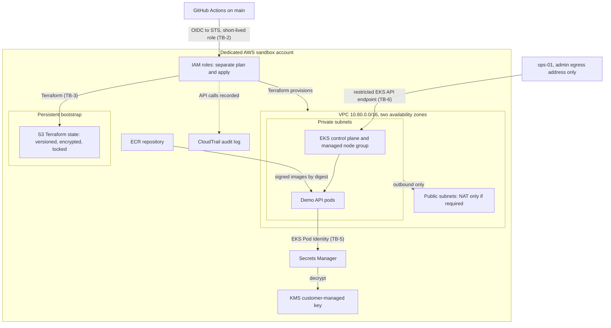

# AWS Environment (planned)

The short-lived AWS sandbox. Everything except the Terraform state bootstrap is created on demand and destroyed after each session. Labels `TB-n` mark trust boundaries, defined in [trust-boundaries.md](../trust-boundaries.md).

Teardown (TB-8) destroys everything inside the account except the state bootstrap, then audits for anything left behind.
