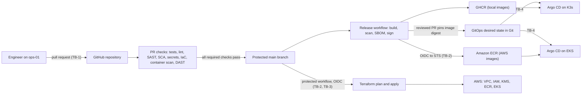

# Delivery Flow

How a change moves from a pull request to a running environment. Labels `TB-n` mark trust boundaries, defined in [trust-boundaries.md](../trust-boundaries.md).

Ownership: GitHub Actions builds and publishes; Terraform owns AWS infrastructure and the initial cluster bootstrap; Argo CD owns everything deployed into Kubernetes after that.

Pull request jobs never receive cloud credentials. Only workflows running from the protected `main` branch can request AWS roles.
