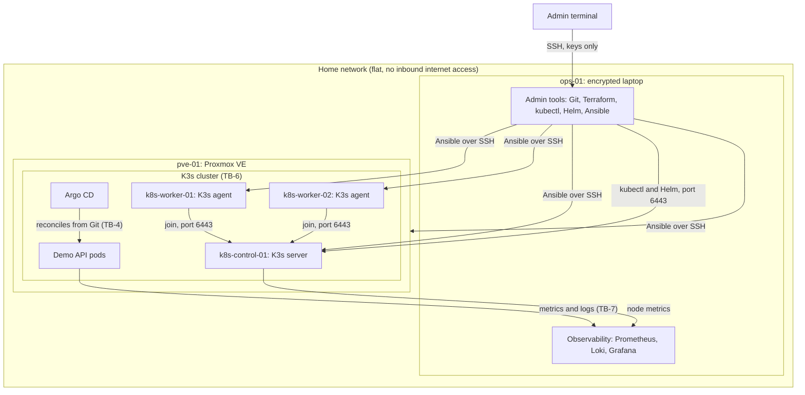

# Local Lab

Physical hosts, virtual machines, and what manages each layer. Labels `TB-n` mark trust boundaries, defined in [trust-boundaries.md](../trust-boundaries.md).

Ownership: Ansible configures every host; K3s runs the cluster services; Argo CD deploys workloads from Git.

Observability runs on `ops-01`, outside the cluster and the hypervisor, so dashboards keep working while the cluster is deliberately broken.
